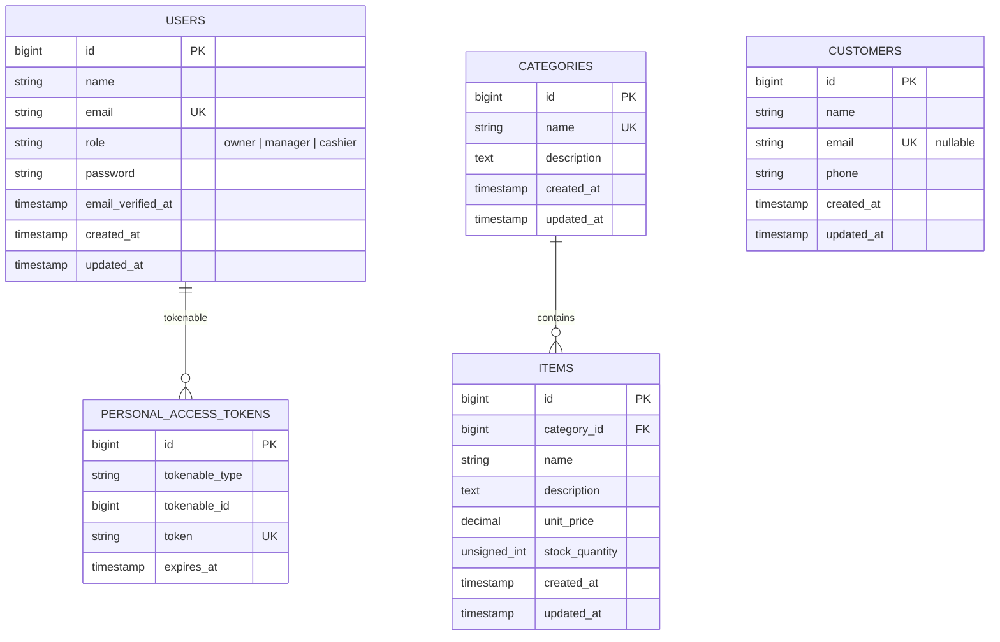

# ScoopPOS Database Design

## Chosen schema

The assessment does not prescribe entity attributes. This project uses categories to represent ice cream flavor groups, such as Vanilla, Chocolate, and Strawberry. Every inventory item belongs to one category. Customers do not have an order/sale relationship in the assessment scope, so no such table has been introduced.

- `users.role` is a string-backed `UserRole` enum (`owner`, `manager`, `cashier`) and is indexed for later authorization queries.
- `categories.name` is unique.
- `items.category_id` is required and references `categories.id` with `ON DELETE RESTRICT`; a category with inventory cannot be deleted.
- `customers.email` is optional but unique when present. This allows walk-in customers without an email while preventing duplicate supplied emails.
- Laravel Sanctum's existing `personal_access_tokens` table is polymorphically related to `users` when bearer-token authentication is added in the authentication phase.
- `DatabaseSeeder` creates Owner, Manager, and Cashier development accounts plus three flavor categories and inventory items. Each seeded development account uses the password `password`, which is hashed before storage and must be changed outside local development.

## Mermaid ER diagram

