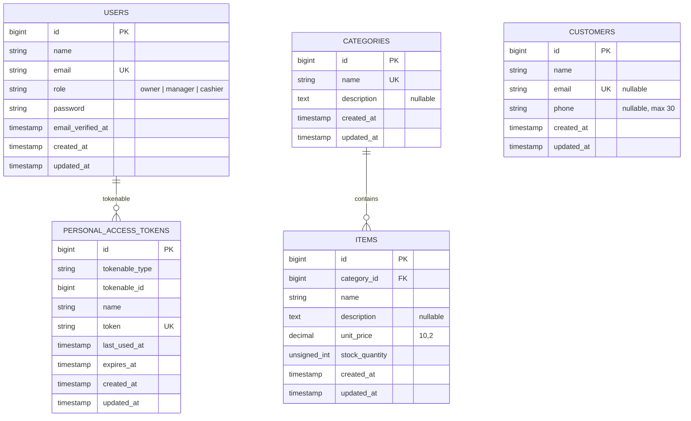

# ScoopPOS ER Diagram

This diagram reflects the current Laravel migrations. `personal_access_tokens` is Laravel Sanctum's polymorphic token table; a token belongs to a user in this application.

`items.category_id` uses `ON DELETE RESTRICT`, so a category with inventory cannot be deleted. Customers intentionally have no sales/order relation because those entities are outside the assessment scope.
